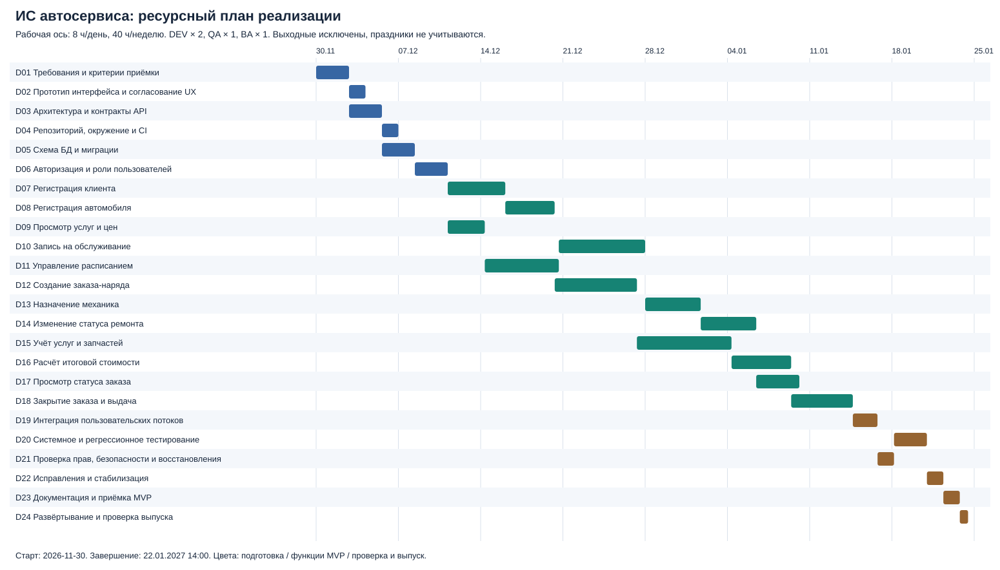

# Фаза 5. Ресурсное планирование реализации ИС автосервиса

**Команда учебного проекта:** Роде, Солопанов, Пухов.
**Объект планирования:** создание программного MVP из 12 Use Cases фазы 3. План охватывает полный цикл подготовки, разработки, проверки и выпуска MVP.

## 1. Основание плана и состав команды реализации

В фазе 3 получены 90 CFP, 107,8378 UCP, оценка функциональной трудоёмкости **368 чел.-ч** и альтернативный сценарий UCP × 8 = **862,7024 чел.-ч**. CFP и UCP не являются часами и не складываются с ними.

Базовый план использует 368 чел.-ч как объём **функциональной разработки**, сохраняя оценки каждого UC. Добавлены общие работы: требования, UX, архитектура, инфраструктура, БД, авторизация, интеграция, тестирование, исправления, приёмка и выпуск — ещё **200 чел.-ч**. Итого **568 чел.-ч**. В плане функциональная разработка и общепроектные работы разделены: 368 ч относятся к реализации UC, 200 ч — к перечисленным общим работам.

| Тип ресурса | Количество | Требуемые навыки и обязанности |
|---|---:|---|
| DEV | 2 | Универсальные backend/frontend-разработчики, API, БД, автоматические проверки. Минимум один умеет настраивать CI, развёртывание и восстановление. |
| QA | 1 | Тестирование основных, альтернативных и негативных сценариев, прав доступа, регрессии и приёмки. |
| BA | 1 | Аналитик/PM с навыками простого UX: границы MVP, критерии приёмки, прототип, документация. |

Команда реализации состоит из **4 специалистов**. Специализации — возобновляемые ресурсы: после завершения задачи специалист становится доступен следующей. Идентификаторы исполнителей в графике: DEV-1, DEV-2, QA-1, BA-1. Ответственность студентов за учебные расчёты зафиксирована в общей RACI.

Фаза 3 предлагала двух разработчиков и частично занятых QA/аналитика. Здесь QA и BA можно привлекать только на нужные интервалы, но в эти интервалы они доступны 8 ч/день без конкурирующих внешних задач. Для разработчиков гарантирована полная доступность. Средняя занятость в найденном графике: **DEV 78,86% общей мощности, QA 11,36%, BA 10,09%**. Отдельный DevOps не нужен, его задачи выполняет DEV.

## 2. Декомпозиция на 24 задачи

Длительность `d` — часы на рабочей оси графика; трудоёмкость — `d × Σr`. Например, D19 длится 12 рабочих часов и требует двух разработчиков одновременно: 24 чел.-ч. Предшествование — finish-to-start, без лагов. Функциональная задача включает UI, API и локальные проверки разработчика. Системная проверка выделена отдельно.

| ID | Работа | d, раб.ч | DEV | QA | BA | Предшественники | UC |
|---|---|---:|---:|---:|---:|---|---|
| D01 | Требования и критерии приёмки | 16 | 0 | 0 | 1 | — | — |
| D02 | Прототип интерфейса и согласование UX | 8 | 1 | 0 | 1 | D01 | — |
| D03 | Архитектура и контракты API | 16 | 1 | 0 | 0 | D01 | — |
| D04 | Репозиторий, окружение и CI | 8 | 1 | 0 | 0 | D03 | — |
| D05 | Схема БД и миграции | 16 | 1 | 0 | 0 | D03 | — |
| D06 | Авторизация и роли | 16 | 1 | 0 | 0 | D02; D04; D05 | — |
| D07 | Регистрация клиента | 28 | 1 | 0 | 0 | D06 | UC01 |
| D08 | Регистрация автомобиля | 24 | 1 | 0 | 0 | D07 | UC02 |
| D09 | Просмотр услуг и цен | 18 | 1 | 0 | 0 | D06 | UC03 |
| D10 | Запись на обслуживание | 42 | 1 | 0 | 0 | D08; D09; D11 | UC04 |
| D11 | Управление расписанием | 36 | 1 | 0 | 0 | D06 | UC05 |
| D12 | Создание заказа-наряда | 40 | 1 | 0 | 0 | D08 | UC06 |
| D13 | Назначение механика | 27 | 1 | 0 | 0 | D11; D12 | UC07 |
| D14 | Изменение статуса ремонта | 27 | 1 | 0 | 0 | D13 | UC08 |
| D15 | Учёт услуг и запчастей | 46 | 1 | 0 | 0 | D09; D12 | UC09 |
| D16 | Расчёт итоговой стоимости | 29 | 1 | 0 | 0 | D15 | UC10 |
| D17 | Просмотр статуса заказа | 21 | 1 | 0 | 0 | D14 | UC11 |
| D18 | Закрытие заказа и выдача | 30 | 1 | 0 | 0 | D14; D16 | UC12 |
| D19 | Интеграция пользовательских потоков | 12 | 2 | 0 | 0 | D10; D17; D18 | — |
| D20 | Системное и регрессионное тестирование | 16 | 1 | 1 | 0 | D19 | — |
| D21 | Права, безопасность и восстановление | 8 | 1 | 1 | 0 | D19 | — |
| D22 | Исправления и стабилизация | 8 | 2 | 0 | 0 | D20; D21 | — |
| D23 | Документация и приёмка MVP | 8 | 0 | 1 | 1 | D22 | — |
| D24 | Развёртывание и проверка выпуска | 4 | 1 | 1 | 0 | D23 | — |

Полные машинно-читаемые данные — `inputs.json` и `Задачи_реализации.csv`. Все UC01–UC12 покрыты ровно один раз, функциональность не сокращалась. Длительности и ресурсы заданы для каждой задачи и используются во всех проверяемых порядках приоритетов.

## 3. Математическая постановка RCPSP

Минимизируется `Cmax = max_i(s_i+d_i)`, где `s_i` — начало задачи в рабочих часах. Ограничения:

1. `s_i >= 0`, все начала целочисленные.
2. Для каждого предшественника `j`: `s_i >= s_j+d_j`.
3. В каждый рабочий час `t` и для каждой специализации `k`: `Σ r_ik [s_i <= t < s_i+d_i] <= R_k`.
4. Задача занимает непрерывный интервал рабочей оси, ресурсный состав постоянен. Ночь и выходные не входят в эту ось.

Мощности: `R_DEV=2`, `R_QA=1`, `R_BA=1`. Используется детерминированная модель с постоянными мощностями ресурсов и длительностями задач.

## 4. Приоритеты и построение расписания

Сначала прямым и обратным проходом по DAG рассчитаны EST/EFT/LST/LFT без ресурсных ограничений, общий и свободный резервы (`CPM.csv`). Для терминальных задач используется общий виртуальный финиш проекта.

Пусть `Succ(i)` — **прямые** последователи, `r_i=Σ_k r_ik`.

| Правило | Ключ сортировки |
|---|---|
| SLK | По возрастанию `LST−EST` |
| FREE | По возрастанию `min EST последователей − EFT` |
| LST / LFT | По возрастанию позднего начала / завершения |
| LSTLFT | По возрастанию `LST+LFT` |
| GRPW | По убыванию `d_i+Σ_{j∈Succ(i)}d_j` |
| LPT | По убыванию `d_i` |
| MIS | По убыванию числа прямых последователей |
| GRD | По убыванию `d_i × r_i` |
| GRWC | По убыванию `r_i` |
| GCRWC | По убыванию `r_i+Σ_{j∈Succ(i)}r_j` |
| ROT | По убыванию `(Σ_k r_ik/R_k)/d_i` |

При равном ключе используется ID задачи. Каждое правило даёт список приоритетов. Serial Schedule Generation Scheme выбирает задачу с наивысшим приоритетом **среди тех, чьи предшественники уже размещены**, затем вставляет её в самый ранний допустимый интервал с учётом уже зарезервированных ресурсов. Проверяются освобождения ресурсов, возможна вставка в ранний свободный промежуток. Перестановка приоритетов не обязана быть топологической: допустимость обеспечивает SGS.

Испытаны **12 правил и 5 000 случайных перестановок** с seed `5052026`. Случайные выборки не требуют уникальности; каждая проверяется. В каждой из 5 012 полученных реализаций отдельно проверяются длительности, все связи и почасовое использование ресурсов. Критерий выбора — минимальный Cmax, при равенстве — минимальная сумма времён завершения. При полном равенстве сохраняется первое решение.

## 5. Сравнение результатов

| Приоритет | Рабочих часов | Эквивалент рабочих дней |
|---|---:|---:|
| SLK | 329 | 41,125 |
| FREE | 329 | 41,125 |
| LST | 329 | 41,125 |
| LFT | 338 | 42,250 |
| LSTLFT | 329 | 41,125 |
| GRPW | 335 | 41,875 |
| LPT | 346 | 43,250 |
| MIS | 337 | 42,125 |
| GRD | 346 | 43,250 |
| GRWC | 321 | 40,125 |
| GCRWC | 337 | 42,125 |
| ROT | 321 | 40,125 |
| **Лучший случайный, RANDOM-0006** | **317** | **39,625** |
| Худший случайный | 364 | 45,500 |

Лучшие именованные эвристики — GRWC и ROT, по 321 ч. Случайный поиск улучшил Cmax на **4 ч (1,25%)**. По дополнительному критерию ROT имеет сумму завершений 4 088 ч, GRWC — 4 096 ч. Результаты 12 эвристик и лучший/худший случайные порядки записаны в `Сравнение_эвристик.csv`; лучший список приоритетов — в `metrics.json`. Все 5 000 случайных порядков воспроизводятся по seed.

Нижняя граница по критическому пути без ресурсов — **309 ч**. По суммарной нагрузке получаем `ceil(500/2)=250 ч` для DEV, 36 ч для QA и 32 ч для BA.

**Оптимальность подтверждается усиленной ресурсной границей.** D20 и D21 требуют по одному QA при мощности QA=1, поэтому выполняются последовательно. Самое раннее завершение D19 — час 273. Далее необходимы D20 и D21 (16+8 ч), D22 (8 ч), D23 (8 ч), D24 (4 ч). Следовательно, любой график длится не менее `273+16+8+8+8+4 = 317 ч`. Проверка обеих ориентаций D20→D21 и D21→D20 даёт ту же границу. Найденный допустимый график имеет длительность **317 ч**, значит он **оптимален для заданной модели**. Сертификат границы сохранён в `metrics.json`.

## 6. Рабочий календарь и сроки этапов

Плановый старт — **30.11.2026 09:00**. График — **понедельник–пятница, 09:00–17:00**, 8 рабочих часов в день, 40 в неделю. Используется календарь постоянной 40-часовой рабочей недели из задания; рабочие часы идут непрерывно с 09:00 до 17:00, суббота и воскресенье исключаются.

Для рабочего часа `h`: день определяется целой частью `h/8`, часы — остатком. Выходные пропускаются. Завершение на границе дня относится к 17:00 текущего дня, следующее начало — к 09:00 следующего рабочего дня. Например, конец часа 40 — пятница 17:00, начало часа 40 — понедельник 09:00.

| Этап | Интервал рабочей оси | Начало | Завершение |
|---|---|---|---|
| Подготовка, D01–D06 | [0; 64) | 30.11.2026 09:00 | 09.12.2026 17:00 |
| Функции MVP, D07–D18 | [64; 261) | 10.12.2026 09:00 | 13.01.2027 14:00 |
| Проверка и выпуск, D19–D24 | [261; 317) | 13.01.2027 14:00 | **22.01.2027 14:00** |

Итоговая длительность — **317 рабочих часов = 39,625 рабочих дня = 7,925 рабочей недели**, завершение в течение 40-го рабочего дня. Полный график с конкретными модельными исполнителями — `Календарный_план.csv`, этапы — `Этапы.csv`. Почасовые ресурсные ограничения проверяются кодом для каждого графика.



## 7. Сопоставление с фазами 3 и 4

В фазе 3 при мощности 60–80 чел.-ч/неделю назывался ориентир 6–8 недель для 368 ч с резервом. В текущем плане **568 чел.-ч**, гарантированная доступность ресурсов и явные зависимости. Средняя фактическая загрузка всей модельной команды за график: `568/7,925 = 71,67 чел.-ч/неделю`. Она попадает в диапазон мощности фазы 3, но отдельные недели требуют большей доступности. Поэтому средняя загрузка не заменяет проверку конкретного почасового графика.

Оценка UCP × 8 = 862,70 чел.-ч используется для сопоставления масштаба. Базовый график построен по 368 ч функциональных задач и 200 ч общих работ; D22 учитывает исправления и стабилизацию.

Прогнозы **10/13 недель фазы 4 относятся к выполнению учебного планирования студентами**. График **7,925 недели фазы 5 относится к разработке продукта модельной командой**. Их нельзя складывать или считать взаимным противоречием.

## 8. Воспроизведение и проверка

```sh
python3 scripts/solve_phases45.py --phase 5
python3 -m unittest discover -s scripts -p 'test_*.py' -v
```

Код использует только стандартную библиотеку Python 3. Параметры и оценки меняются в `inputs.json`, после чего генерируются таблицы и SVG. Текстовые выводы отчёта после изменения входов необходимо сверить с обновлёнными `metrics.json`.

Проверены: отсутствие циклов/неизвестных предшественников, допустимость ресурсов, покрытие 12 UC и согласованность функциональной суммы с фазой 3, вставка задач в свободные интервалы, календарные границы и выходные. Для маленького примера оптимум SGS по всем приоритетам сопоставлен с независимым полным перебором времён начала. Все 5 012 графиков основной модели прошли проверку ограничений. Общий набор — 14 тестов, включая проверку ресурсной нижней границы и сертификата оптимальности.

Учебные работы P5-01–P5-12 декомпозированы в фазе 4 и распределены в `shared/RACI.csv`; ссылки на GitHub Issues находятся в `shared/Issues_фаз_4_5.md`. Учёт времени учебных работ ведётся в `shared/Учёт_времени.csv`. Пользователь подтвердил соответствие оценок фактически затраченному времени.

Фактическая трудоёмкость учебных работ фазы 5 — **30 чел.-ч**, подтверждено пользователем. Она совпала с суммой наиболее вероятных оценок и находится внутри диапазона 17–50 чел.-ч, заданного в фазе 4.
